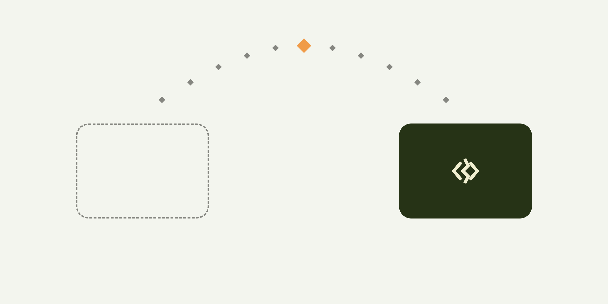

<p align="center">
  <picture>
    <source media="(prefers-color-scheme: dark)" srcset=".github/assets/cover-dark.png">
    
  </picture>
</p>

<h1 align="center">TrackpadSwitch</h1>

<p align="center">
  Move one Apple Magic Trackpad between two Macs signed in to different Apple Accounts, from the menu bar.
</p>

<p align="center">
  <a href="https://github.com/abereghici/trackpad-switch/actions/workflows/ci.yml"></a>
  <a href="LICENSE"></a>
  
</p>

> [!IMPORTANT]
> Pre-release. The core logic is unit-tested and the app builds in CI, but switching and linking have not yet been run on two real Macs.

## Why

To use one Magic Trackpad on two Macs signed in to different Apple Accounts, such as a personal and a work Mac, you remove it in Bluetooth settings on one Mac and pair it on the other each time. TrackpadSwitch does that hand-over with one click or a keyboard shortcut. The two Macs coordinate directly over Bluetooth LE, with no network and no shared account.

## Requirements

- Two Macs with macOS 14 or later, within Bluetooth range, both running TrackpadSwitch with Bluetooth permission
- Automatic date and time on both Macs: a command is accepted only if the clocks are within 30 seconds of each other
- A Magic Trackpad. Other Bluetooth keyboards and mice can be chosen too, but are untested.

## Install

There is no release yet; [build from source](CONTRIBUTING.md#building).

Releases will be a zip of the app, signed with Developer ID, notarized by Apple, and published with a SHA-256 checksum. TrackpadSwitch can't be distributed on the Mac App Store, because unpairing a device uses a private IOBluetooth method ([App Review Guideline 2.5.1](https://developer.apple.com/app-store/review/guidelines/#2.5.1)).

## Setup

1. On the Mac that has the trackpad, open TrackpadSwitch Settings and choose the trackpad under **Device**.
2. Open Settings on the other Mac too, then click **Link a Mac** on both.
3. Check that both Macs show the same 6 digits, then click **They Match** on both. The other Mac takes its device choice from the first, so it doesn't need to pair the trackpad first.
4. Optional: record a shortcut under **Shortcut**.

## Usage

- **Bring <device> Here** in the menu moves the trackpad to this Mac; **Send to <Mac>** moves it to the other Mac. The menu bar icon shows a filled diamond when the trackpad is on this Mac and an outlined diamond when it isn't.
- The shortcut does whichever of the two applies.
- Apps and scripts can open `trackpadswitch://take`, `trackpadswitch://send` or `trackpadswitch://toggle`, for example `open -g trackpadswitch://toggle`.
- With **Hand the device to your other Mac when this Mac sleeps** on (the default), a Mac about to sleep sends the trackpad to the other Mac first, if the other Mac answers.
- **Unlink** in Settings removes the link on that Mac only. Unlink on both Macs, then link again.

## How it works

1. The Mac that wants the trackpad sends an authenticated `release` command to the other Mac over Bluetooth LE.
2. The other Mac unpairs the trackpad, or disconnects it if it can't unpair, and acknowledges.
3. The first Mac connects the trackpad, pairing it again if needed.

**Send** is the reverse: a Mac releases the trackpad only after the other Mac has accepted the request to take it, whether you send it or the Mac goes to sleep. [`SwitcherTests.swift`](Packages/TrackpadSwitchCore/Tests/TrackpadSwitchCoreTests/SwitcherTests.swift) tests both flows against this rule.

Linking runs LE Secure Connections numeric comparison ([Bluetooth Core Specification v5.4](https://www.bluetooth.com/specifications/specs/core-specification-5-4/), Vol 3, Part H, 2.3.5.6.2) inside the app's own messages: a P-256 key exchange, a commitment, and 6 digits that the person compares on both Macs. Its functions are tested against the specification's sample data ([`SecureConnectionsTests.swift`](Packages/TrackpadSwitchCore/Tests/TrackpadSwitchCoreTests/SecureConnectionsTests.swift)).

[`Packages/TrackpadSwitchCore`](Packages/TrackpadSwitchCore) makes the switching and linking decisions and has no hardware access; [`App/`](App) holds thin adapters for IOBluetooth, CoreBluetooth and the Keychain, and the SwiftUI interface.

## Privacy

- **No network access.** TrackpadSwitch communicates only over Bluetooth: the built app imports no networking function or framework, and it collects no analytics.
- **Stored data:** the link key in the Keychain; in preferences, the chosen device's address and name, the linked Mac's name, the sleep option and the keyboard shortcut.
- **Visible to nearby devices:** while linked, each Mac advertises a Bluetooth LE service whose UUID is derived from the link key and stays the same until the Macs are linked again, so a scanner can recognise the Mac across sightings. While linking, the Mac's name and the device's name and address are sent authenticated but unencrypted.
- **Logs** stay in the Mac's unified log. Messages that name the device are logged as private.

The security design, with its evidence and limits, and how to report a vulnerability are in [SECURITY.md](SECURITY.md).

## Troubleshooting

| Message or symptom | What to do |
| --- | --- |
| "Your other Mac didn't answer." | Make sure Bluetooth is on on both Macs, and that the other Mac is awake, in range, running TrackpadSwitch and still linked. |
| "Your other Mac rejected the request." | Turn on automatic date and time on both Macs, and run the same TrackpadSwitch version on both. |
| "Linking didn't finish." | If the other Mac shows it's linked, unlink it there, then link again on both. |
| The trackpad doesn't connect | Switch it off and on, then try again. |

To see each step with its outcome and duration:

```sh
/usr/bin/log show --last 10m --style compact --predicate 'subsystem == "dev.bereghici.trackpadswitch"'
```

## Uninstall

1. Turn off **Launch at login**, quit TrackpadSwitch and delete it from Applications.
2. `defaults delete dev.bereghici.trackpadswitch`
3. `security delete-generic-password -s dev.bereghici.trackpadswitch -a link-secret`

## Contributing

See [CONTRIBUTING.md](CONTRIBUTING.md) for building, testing and releasing. Changes are listed in [CHANGELOG.md](CHANGELOG.md).

## License

[MIT](LICENSE) © Alexandru Bereghici
